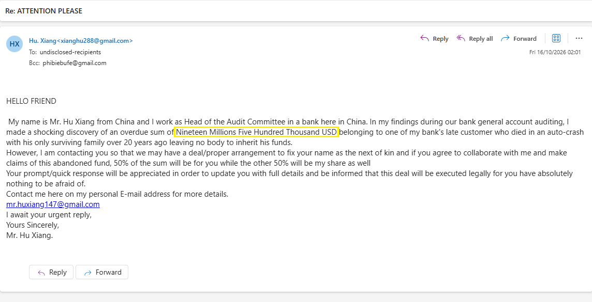
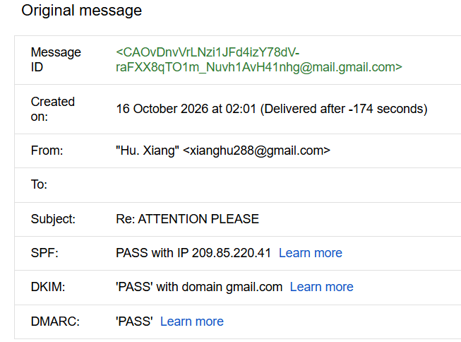

# Incident Report: Advance-Fee Fraud (419 Scam) Campaign - "Mr. Hu Xiang"
<p align="left">
  
  
  
  
  
</p>

## 🔹Executive Summary
This case involves a persistent Advance-Fee Fraud campaign (often referred to as a "419 scam") relying entirely on psychological manipulation and social engineering. The threat actor impersonates a Chinese banking official ("Mr. Hu Xiang") offering a fabricated $19.5 million inheritance. 

The campaign does not utilize malicious links or attachments; instead, it aims to establish a dialogue with the victim to eventually extort "administrative" fees or steal personally identifiable information (PII). The attacker utilizes a rotation of free, legitimate webmail infrastructure (Gmail) to bypass standard security filters and maintain persistence across multiple delivery waves.

## 🔹Campaign Evolution & Email Triage
The threat actor is actively rotating burner accounts to evade detection. Two distinct waves have been intercepted targeting the same BCC address (`phibiebufe@gmail.com`).

**Wave 1 (Initial Contact):**
*   **Subject:** Requires Urgent Attention(USD19.5M)
*   **From:** Mr Hu Xiang `<mrhuxiang34@gmail.com>`
*   **Reply-To:** `mrhuxiang35@gmail.com`
*   **Date:** Sun, 27 Sep 2026

**Wave 2 (Follow-up / Account Rotation):**
*   **Subject:** Re: ATTENTION PLEASE
*   **From:** Hu. Xiang `<xianghu288@gmail.com>`
*   **Contact Requested In-Body:** `mr.huxiang147@gmail.com`
*   **Date:** Fri, 16 Oct 2026

- **Wave 2 Email Body:**
  

**Spoofing & Evasion Indicators:**
*   **Mass-Mailing (BCC):** The continuous use of `undisclosed-recipients:;` confirms this is a "spray-and-pray" mass mailing campaign rather than a targeted attack.
*   **Infrastructure Rotation:** The attacker constantly changes the sending address (e.g., `mrhuxiang34`, `xianghu288`) and the collection address (`mrhuxiang35`, `mr.huxiang147`) as older accounts are burned by spam filters.
*   **Filter Evasion (Text Obfuscation):** In Wave 2, the attacker shifted from writing "USD19,500,000.00" to "Nineteen Millions Five Hundred Thousand USD" to bypass regular expression (regex) filters looking for large currency figures.

## 🔹Email Authentication Analysis

 **Raw Header Analysis:**
  

| Control | Result | Assessment |
|----------|----------|----------|
| SPF | Pass | Email originated from authorized Google infrastructure. |
| DKIM | Pass | Message integrity preserved through Google's cryptographic signature. |
| DMARC | Pass | Alignment checks passed as the sender domain matches the DKIM signature domain (`gmail.com`). |

**Analyst Assessment:**

Successful SPF, DKIM, and DMARC validation in this instance is a false indicator of safety. The threat actor is not spoofing a domain; they are abusing legitimate, reputable infrastructure (Google/Gmail) to distribute fraudulent content. This ensures high deliverability rates and easily bypasses gateway authentication checks.

## 🔹MITRE ATT&CK Mapping

| Tactic | Technique | ID | Evidence |
|----------|----------|----------|----------|
| Initial Access | Phishing | [T1566](https://attack.mitre.org/techniques/T1566/) | Unsolicited email relying on social engineering to solicit victim interaction. |
| Resource Development | Establish Accounts: Email Accounts | [T1586.002](https://attack.mitre.org/techniques/T1586/002/) | Continuous creation and rotation of free webmail accounts for campaign distribution. |

## 🔹Indicators of Compromise (IOCs)
Given the lack of technical payloads, IOCs are limited to the threat actor's contact infrastructure.

| IOC Type | IOC Value | Source | Description | Risk Level |
| :--- | :--- | :--- | :--- | :--- |
| **Sender Email** | `mrhuxiang34@gmail.com` | Email Header (Wave 1) | Threat actor distribution account | Low |
| **Sender Email** | `xianghu288@gmail.com` | Email Header (Wave 2) | Threat actor distribution account | Low |
| **Reply-To** | `mrhuxiang35@gmail.com` | Email Header (Wave 1) | Threat actor collection account | Medium |
| **Contact Email**| `mr.huxiang147@gmail.com` | Email Body (Wave 2) | Threat actor collection account | Medium |

## 🔹Payload & Content Analysis
*   **Attachments/Links:** `None`.
*   **Analysis:** The emails rely entirely on text-based persuasion. The narrative leverages a high-pressure scenario ("overdue sum," "urgent reply") and the promise of a massive financial windfall (50% of $19.5M) to override the victim's critical thinking. Because there is no technical payload (malware, credential harvesting portal), endpoint detection and response (EDR) solutions and sandboxes will not flag the content.

## 🔹Impact Assessment

If a user interacts with the threat actor, the following risks may materialize:
*   **Financial Fraud:** The attacker will eventually demand upfront payments for fabricated taxes, legal fees, or wire transfer costs (Advance-Fee Fraud).
*   **Identity Theft:** The attacker may request copies of passports, driver's licenses, or banking details to "process the transfer," leading to severe PII compromise.
*   **Target List Inclusion:** Replying to the email confirms the victim's address is active and manned by a susceptible individual, guaranteeing a higher volume of future targeted scams.

## 🔹Defensive Recommendations
1.  **Email Gateway Filtering:** Implement rules to flag or quarantine external emails containing high-risk keyword combinations (e.g., "next of kin", "abandoned fund", "Audit Committee") when originating from free webmail domains.
2.  **Sender Blocking:** Blacklist the identified sender and contact addresses (`mrhuxiang34@gmail.com`, `xianghu288@gmail.com`, `mrhuxiang35@gmail.com`, `mr.huxiang147@gmail.com`) to prevent further communication.
3.  **Security Awareness Training:** Use this campaign as a benign, real-world example in employee training to illustrate how authentication (SPF/DKIM) does not guarantee legitimate content, and how to spot 419 scam typologies and account rotation tactics.

## 🔹Attack Timeline

```text
Attacker Creates Free Burner Accounts
       │
       ▼
Mass Distribution via BCC (Wave 1)
       │
       ▼
Accounts Flagged/Burned over Time
       │
       ▼
Attacker Rotates to New Infrastructure
(xianghu288 / mr.huxiang147)
       │
       ▼
Mass Distribution via BCC (Wave 2)
       │
       ▼
Email Delivered to Inbox
       │
       ▼
Social Engineering Lure
"Inheritance / Next of Kin"
       │
       ▼
Expected Victim Action: Email Reply
       │
       ▼
Dialogue Established (Off-Radar)
```
## 🔹 Connect with me
[](https://www.linkedin.com/in/magda-d-infosec)

I am actively seeking a Cyber Security / SOC / Security Design role where I can bring my structured troubleshooting, log analysis, and secure architecture skills to a dedicated security team.