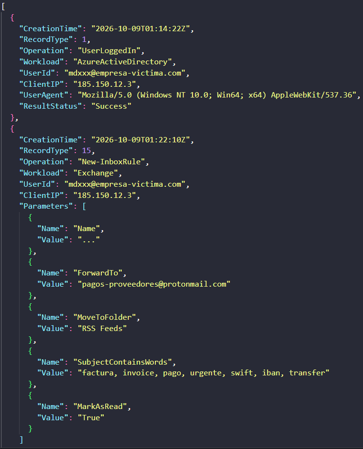

# Incident Report: M365 Business Email Compromise (BEC) & Malicious Forwarding Rule

  
  
  
  
  

## ▫️ Executive Summary
This incident involves a **Business Email Compromise (BEC)** within a Microsoft 365 environment. Following a successful credential compromise, the threat actor accessed the victim's mailbox and established persistence by creating a malicious inbox rule. The rule was designed to automatically forward financial communications to an external ProtonMail address while hiding the intercepted emails in an unused folder ("RSS Feeds") to evade user detection.

## ▫️ Incident Timeline
Analysis of the Microsoft 365 Unified Audit Log (UAL) revealed the following sequence of events:

| Time (UTC) | Event Operation | Details |
| :--- | :--- | :--- |
| **2026-10-09 01:14:22** | `UserLoggedIn` | Successful sign-in to Azure Active Directory from an anomalous IP address (185.150.12.3). |
| **2026-10-09 01:22:10** | `New-InboxRule` | Threat actor accessed Exchange Online and created a hidden inbox rule named `...` to intercept financial emails. |

 **📸 Evidence: UAL JSON Export**

> *Raw JSON extract from the Unified Audit Log confirming the anomalous login and the creation of the hidden forwarding rule.*
## ▫️ Indicators of Compromise (IOCs)

| Type | Indicator | Details | Risk |
| :--- | :--- | :--- | :--- |
| **IP Address** | `185.150.12.3` | Unauthorized source IP used for initial access and mailbox manipulation. | **High** |
| **Email Address** | `pagos-proveedores@protonmail.com` | External address configured as the data exfiltration destination (`ForwardTo`). | **High** |
| **Rule Name** | `...` | Malicious rule name designed to blend in and remain unnoticed by the user. | **Medium** |
| **Keywords** | `factura`, `invoice`, `swift`, `iban` | Triggers used in the `SubjectContainsWords` parameter to target financial data. | **Medium** |

## ▫️ Rule Behaviour Analysis
The threat actor implemented a classic **Man-in-the-Mailbox** evasion technique. According to the extracted JSON parameters:
1. **Targeting:** It scans incoming emails for specific financial keywords.
2. **Exfiltration:** It forwards matches to the attacker's external account.
3. **Evasion:** It immediately marks the email as read (`MarkAsRead: True`) and moves it out of the inbox (`MoveToFolder: RSS Feeds`), ensuring the legitimate user never sees the vendor's invoice or the attacker's reply.

## ▫️ Containment & Response Actions

- [x] **Revoke Active Sessions:** Forced sign-out across all devices via Microsoft Entra ID to sever the attacker's active connection.
- [x] **Reset Credentials:** Enforced an immediate password reset for the compromised account (`mdescudero@empresa-victima.com`) and required MFA re-registration.
- [x] **Rule Remediation:** Manually deleted the malicious inbox rule (`...`) via Exchange Admin Center.
- [x] **IP Blocking:** Added the malicious IP (`185.150.12.3`) to the corporate firewall and conditional access blocklists.
- [x] **Impact Assessment:** Initiated an eDiscovery search in M365 to determine exactly which emails were successfully forwarded to the external ProtonMail address between `01:22:10Z` and the time of containment.

---

### 📝 Report Metadata
`> analyst: Magdalena Dominguez (CISMP | SC-900)`  
`> status: case closed - contained & remediated`  
`> repository: phishing-incident-response-lab`  

