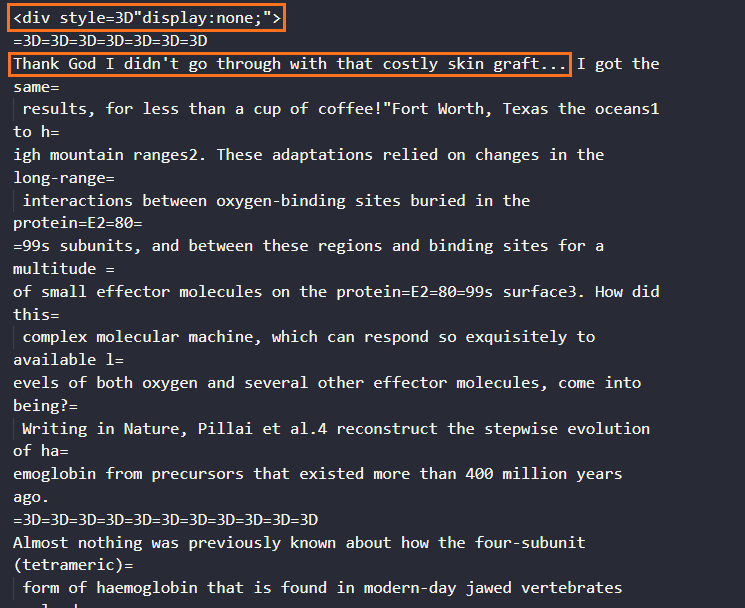
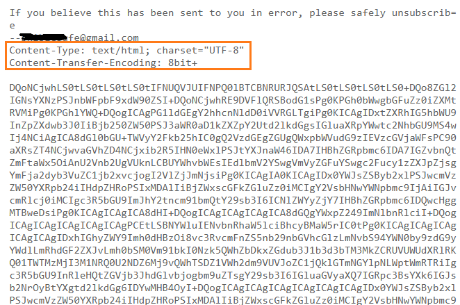

# Incident Report: Mercadona Brand Impersonation & Advanced Evasion Tactics

  
  
  
  
  

## 🔸Executive Summary
This case involves a persistent brand impersonation phishing campaign targeting Spanish consumers by spoofing the supermarket chain **Mercadona**. The threat actor uses a fabricated reward lure (a 40€ fresh food box) to harvest Personally Identifiable Information (PII) and credit card details via fraudulent shipping fees.

The campaign is notable for its advanced Secure Email Gateway (SEG) evasion tactics. Across multiple delivery waves, the attacker demonstrated infrastructure rotation, abuse of legitimate cloud hosting (Google Cloud Storage), **Bayesian Poisoning** (hidden text padding), and full-body **Base64 encoding** to bypass automated content analysis and machine-learning spam filters.

## 🔸Campaign Evolution & Evasion Tactics
The threat actor actively adjusted their operational security (OPSEC) and evasion techniques across three distinct delivery waves over an 11-day period, targeting the same mailbox.

### Wave 1: Initial Obfuscation & Bayesian Poisoning
*   **Date:** Oct 3, 2026
*   **Infrastructure:** Spoofing `OCtOvaU.OCtOvaU.OCtOvaU.fr` via authenticated Return-Path (`callitapp.com`).
*   **Evasion Tactic (Header):** The `Subject` and `From` fields utilized Base64-encoded UTF-8 strings to hide keywords (e.g., "Mercadona") from static regex rules.
*   **Evasion Tactic (Body):** The raw HTML included a hidden `
` tag containing paragraphs of unrelated text (academic articles on haemoglobin). This technique, known as **Bayesian Poisoning** or Hash Busting, artificially lowers the email's spam score by padding it with dictionary-valid, benign words.

  

### Wave 2: Sender Identity Rotation
*   **Date:** Oct 9, 2026
*   **Infrastructure:** The attacker maintained the same landing page (`/salesflow25/eranewmar.html`) but aggressively rotated the sending subdomains.
*   **Evasion Tactic:** The spoofed display domain was shifted to `M17B55z.M17B55z.M17B55z.fr`, and the Return-Path utilized a new, heavily randomized subdomain structure (`30jm7nzurv8fhwd938...callitapp.com`) to bypass domain-based reputation blocks triggered by Wave 1.

### Wave 3: Major Infrastructure Migration & Base64 Payload
*   **Date:** Oct 14, 2026
*   **Infrastructure:** Major rotation to an OVH VPS (`141.94.247.208`) authenticating via `lkgame-auto.com` and spoofing `5s7inwil.com`. The malicious payload was also migrated to a new Google Cloud Storage bucket (`/xacto/storage.datavero.htm`).
*   **Evasion Tactic (Body):** The attacker abandoned the Bayesian Poisoning and instead encoded the entire HTML body in Base64 (`Content-Transfer-Encoding: 8bit+`). This forces the SEG to decode the payload before scanning. Gateways with constrained processing limits often bypass deep inspection of encoded bodies, allowing the phishing lure to reach the inbox.

  

## 🔸Email Authentication Analysis

| Wave | Control | Result | Assessment |
| :--- | :--- | :--- | :--- |
| **Wave 1 & 2** | SPF | Pass | Authorized by Return-Path (`callitapp.com`). |
| **Wave 1 & 2** | DKIM | N/A | No signature present in the raw headers. |
| **Wave 1 & 2** | DMARC | Fail | Strict misalignment between the visible `From` domain (`.fr`) and the Return-Path. |
| **Wave 3** | SPF | Pass | IP `141.94.247.208` authorized by new Return-Path (`lkgame-auto.com`). |
| **Wave 3** | DKIM | Permerror | Signature failed (`no key for signature`), highlighting poor attacker OPSEC during infrastructure migration. |

## 🔸MITRE ATT&CK Mapping

| Tactic | Technique | ID | Evidence |
|----------|----------|----------|----------|
| Initial Access | Phishing: Spearphishing Link | [T1566.002](https://attack.mitre.org/techniques/T1566/002/) | Malicious survey URL embedded in the email. |
| Defense Evasion | Obfuscated Files or Information | [T1027](https://attack.mitre.org/techniques/T1027/) | Hidden HTML `div` tags (Bayesian poisoning) and Base64 body encoding. |
| Resource Development | Acquire Infrastructure: Web Services | [T1583.006](https://attack.mitre.org/techniques/T1583/006/) | Abuse of Google Cloud Storage (`storage.googleapis.com`) to host the landing page. |

## 🔸Indicators of Compromise (IOCs)
The attacker consistently abused `storage.googleapis.com` to host the landing pages, leveraging Google's inherent domain reputation to bypass URL filters.

| IOC Type | IOC Value | Source | Description | Risk Level |
| :--- | :--- | :--- | :--- | :--- |
| **Sender IP** | `46.224.34.207` | Header (Wave 1 & 2) | Hetzner infrastructure | High |
| **Sender IP** | `141.94.247.208` | Header (Wave 3) | OVH VPS infrastructure | High |
| **Return-Path** | `*@*.callitapp.com` | Header (Wave 1 & 2) | Authenticated sending domain | Medium |
| **Return-Path** | `*@lkgame-auto.com` | Header (Wave 3) | Authenticated sending domain | Medium |
| **URL (Defanged)** | `hxxps://storage[.]googleapis[.]com/salesflow25/eranewmar[.]html` | Body (Wave 1 & 2) | Phishing landing page | High |
| **URL (Defanged)** | `hxxps://storage[.]googleapis[.]com/xacto/storage[.]datavero[.]htm` | Body (Wave 3) | Rotated phishing landing page | High |

> ⚡ **Automation Note:** Initial header parsing, IPv4 extraction, payload decoding (Base64), and URL defanging for this investigation were automated using the repository's custom `ioc_extractor.py` and `eml_parser.py` toolkit.

## 🔸Impact Assessment
If a user interacts with the phishing link, the following risks may materialize:
*   **PII Harvesting:** The initial survey acts as a gateway to collect names, physical addresses, and contact details.
*   **Financial Fraud:** Victims are informed they have "won" but must pay a nominal shipping fee (e.g., 1.99€). Submitting this payment compromises the credit card.
*   **Subscription Traps:** The fine print often enrolls the victim in obscure, high-cost recurring monthly subscriptions.

## 🔸Defensive Recommendations
1.  **Granular URL Filtering:** Block the specific URI paths (e.g., `/salesflow25/`, `/xacto/`) on web proxies. *Critical: Do not blacklist the root domain `storage.googleapis.com`, as this will disrupt legitimate business operations.*
2.  **Email Gateway Tuning:** Implement custom YARA rules or SEG policies to quarantine emails containing excessively large hidden HTML blocks (`display:none;`) or unexpected full-body Base64 encoding.
3.  **Threat Intelligence Sharing:** Report the identified malicious Google Cloud Storage buckets to Google Safebrowsing to facilitate takedown.

## 🔸Let's connect

