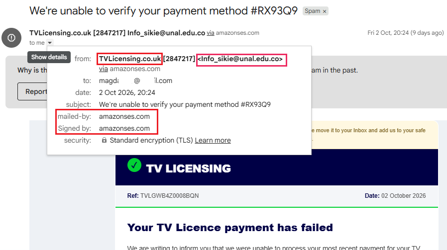

# Incident Report: TV Licensing Phishing via Compromised EDU & Amazon SES

  
  
  
  
  

## ▫️ Executive Summary
This incident involves a credential harvesting and financial fraud campaign targeting UK residents by spoofing the legitimate "TV Licensing" authority. The threat actor demonstrates advanced filter evasion techniques by hijacking a high-reputation educational domain (`unal.edu.co`) and routing the malicious emails through legitimate Amazon Simple Email Service (SES) infrastructure. This combination effectively bypasses traditional Secure Email Gateway (SEG) domain reputation checks.

## ▫️ Email & Header Triage
*   **Subject:** We're unable to verify your payment method #RX93Q9
*   **From:** "TVLicensing.co.uk [2847217]" `<Info_sikie@unal.edu.co>`
*   **To:** magdaxxxxx@gmail.com
*   **Date:** Fri, 02 Oct 2026 19:24:49 +0000
*   **Return-Path:** `<010001a0fe138d40-dffcd81d-83a3-4474-a799-d72e345b087e-000000@amazonses.com>`
*   **Message-ID:** `<010001a0fe138d40-dffcd81d-83a3-4474-a799-d72e345b087e-000000@email.amazonses.com>`

- **📸 Sender Discrepancy & Cloud Abuse:**

- **Spoofing & Evasion Indicators:**
  *   **Educational Domain Hijacking:** The sender address belongs to the National University of Colombia (`unal.edu.co`). Threat actors frequently target `.edu` accounts because spam filters assign them inherently high trust scores.
  *   **Brand Mismatch:** The Display Name ("TVLicensing.co.uk") directly contradicts the sender's domain (Colombia) and the target audience (UK).
  *   **Cloud Infrastructure Abuse:** The `Return-Path` and `Message-ID` confirm the email was successfully authenticated and relayed through Amazon SES (`amazonses.com`). This ensures the email passes SPF/DKIM checks, maximizing deliverability to the victim's inbox.

## ▫️ Tactical Observations & Infrastructure Analysis
The email attempts to create artificial urgency regarding a failed payment method to trick the victim into clicking a malicious link. 

*   **Filter Bypass Strategy:** By leveraging Amazon SES, the attackers do not need to build or warm up their own SMTP servers. They rely entirely on Amazon's pristine IP reputation. 
*   **Phishing Payload:** While the exact URL was obfuscated, the typical attack chain for this lure involves redirecting the victim to a cloned TV Licensing portal designed to harvest personally identifiable information (PII) and credit card details.

- **📸 Automated Triage Output:**

## ▫️ Defensive Recommendations
1.  **Suspicious Display Name Rules:** Implement YARA or regex-based transport rules on the email gateway to flag or quarantine external emails where the Display Name contains "TVLicensing" but the Envelope-Sender domain does not match `*.tvlicensing.co.uk`.
2.  **Granular Sender Blocking:** Do not block `amazonses.com` at the root level, as this will disrupt legitimate business communications. Instead, add the specific compromised address `Info_sikie@unal.edu.co` to the organization's deny list.
3.  **Threat Intelligence Reporting:** Report the compromised account to the abused institution's IT department and flag the malicious SES routing IDs to Amazon AWS Abuse to help take down the attacker's infrastructure.

## ▫️ Let's connect

