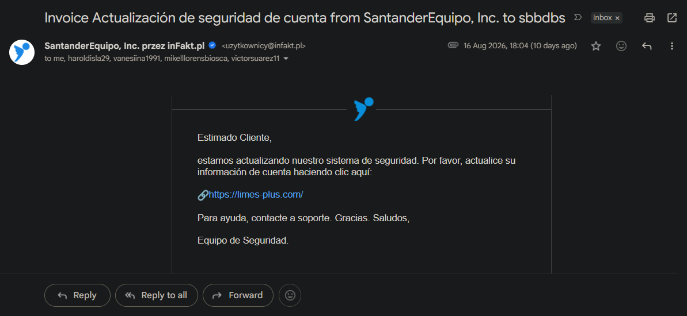
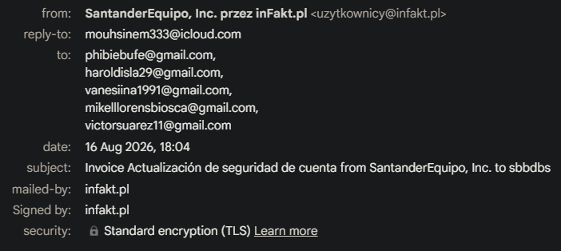
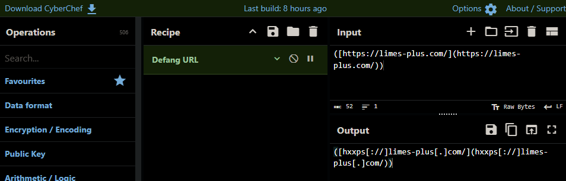
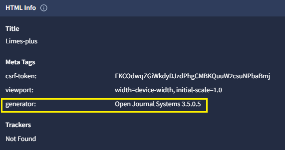
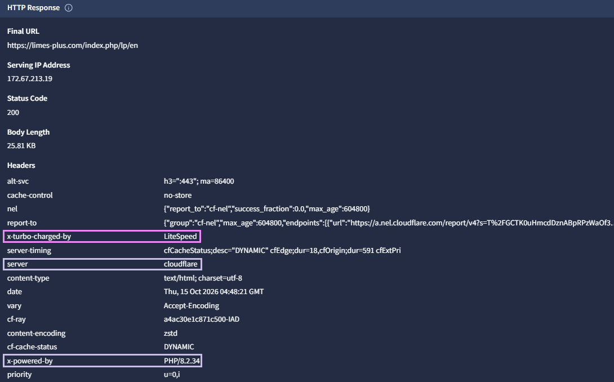
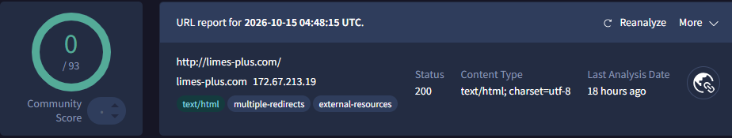
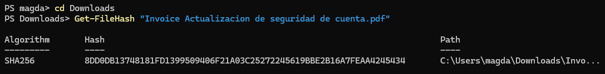
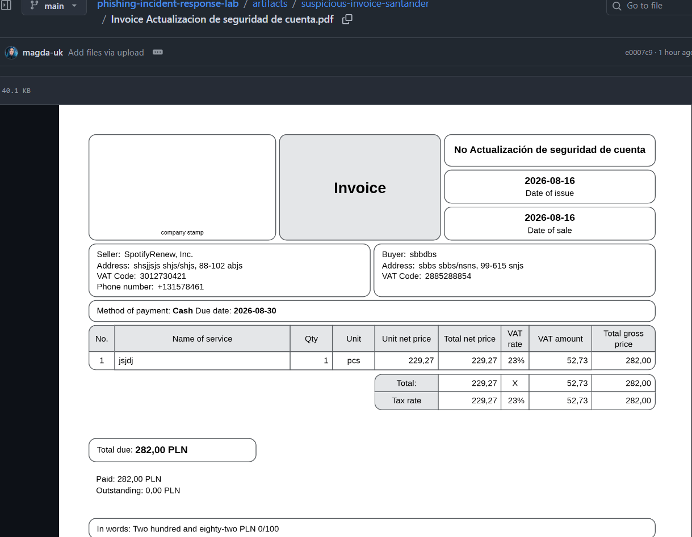
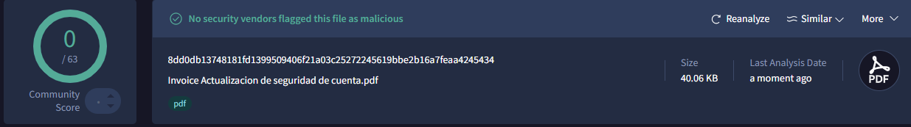

# Incident Report: Santander Spoofed Security Update
<p align="left">
  
  
  
  
  
</p>

## 🔹Executive Summary
This case involves a real-world phishing campaign impersonating Santander ("SantanderEquipo, Inc."). The attacker leveraged a legitimate Polish invoicing service (`infakt.pl`) to spoof the delivery mechanism and bypass basic spam filters. The primary objective is credential harvesting via a malicious external link, using a fabricated PDF invoice as a psychological trigger to create urgency.

## 🔹Email & Header Triage
*   **Subject:** Invoice Actualizacion de seguridad de cuenta
*   **From:** SantanderEquipo, Inc. <uzytkownicy@infakt.pl>
*   **Reply-To:** mouhisenm333@icloud.com
*   **Message-ID:** `<80e64edf394b9cc28266b09e9d20a56ea30a3c649e5a52772410d4044594@mail.app.infakt.pl>`
*   **Recipients:** Multiple unrelated victims (Mass-targeting).

* **Email Overview & Headers:**



* **Spoofing & Evasion Indicators:**
  *   **Domain Mismatch:** The sender domain (`infakt.pl`) completely contradicts the display name (Santander).
  *   **Suspicious Reply-To:** Diverts replies to a personal iCloud email, a classic operational security failure by the threat actor.

## 🔹Email Authentication Analysis

Authentication mechanisms should always be reviewed when investigating phishing campaigns, as threat actors increasingly abuse legitimate email services to distribute malicious content.

  | Control | Result | Assessment |
  |----------|----------|----------|
  | SPF | Pass* | Email originated from authorised infrastructure associated with `infakt.pl`. |
  | DKIM | Pass* | Message integrity preserved through the legitimate sending platform. |
  | DMARC | Pass* | Alignment checks likely passed due to the abuse of a trusted third-party service. |

  > *Authentication results should be verified directly from the message headers.

 * **Analyst Assessment**

    Successful SPF, DKIM and DMARC validation does not automatically indicate a legitimate email.

    In this case, the threat actor abused a legitimate invoicing platform (`infakt.pl`) to distribute phishing content. This technique increases delivery success rates and reduces the likelihood of email gateway filtering.


## 🔹MITRE ATT&CK Mapping

| Tactic | Technique | ID | Evidence |
|----------|----------|----------|----------|
| Initial Access | Phishing: Spearphishing Attachment | [T1566.001](https://attack.mitre.org/techniques/T1566/001/) | PDF attachment used as a social engineering lure |
| Initial Access | Phishing: Spearphishing Link | [T1566.002](https://attack.mitre.org/techniques/T1566/002/) | Email directs victims to an external phishing website |
| Resource Development | Compromise Infrastructure | [T1584](https://attack.mitre.org/techniques/T1584/) | Legitimate website suspected of hosting phishing content |
| Credential Access | Input Capture: Web Portal Capture | [T1056.003](https://attack.mitre.org/techniques/T1056/003/) | Expected credential harvesting through fake banking page |
---
> MITRE ATT&CK mappings are based on observed attacker behaviour and available evidence collected during the investigation.
 
 **Primary Assessment**

  The phishing URL represents the primary attack vector. The PDF serves as a supporting social engineering artefact designed to increase trust and drive victim interaction with the malicious link.

## 🔹Indicators of Compromise (IOCs)
Extracted artifacts identified during the initial triage for threat intelligence lookups and SIEM log searches.

| IOC Type | IOC Value | Source | Description | Risk Level |
| :--- | :--- | :--- | :--- | :--- |
| **Sender Email** | `uzytkownicy@infakt.pl` | Email Header | Compromised or abused legitimate invoicing service | High |
| **Reply-To** | `mouhisenm333@icloud.com` | Email Header | Attacker-controlled personal email address | High |
| **Message-ID** | `<80e64edf394b9cc28266b09...>` | Email Header | Unique message identifier | Medium |
| **URL (Visible)** | `http://limes-plus.com/` | Email Body | Fake security update landing page | High |
| **Domain** | `limes-plus.com` | Email Body | Root domain with no Santander affiliation | High |
| **IP Address** | `172.67.213.19` | VirusTotal / DNS | Resolved IP of the malicious domain | High |
| **Attachment Name**| `Invoice Actualizacion de seguridad de cuenta.pdf` | Attachment | Suspicious attachment acting as a social engineering lure | High |
| **Attachment Hash**| `8dd0db13748181fd1399509406f21a03c25272245619bbe2b16a7feaa4245434` | Attachment | SHA256 hash of the PDF attachment | High |


## 🔹URL & Infrastructure Analysis
The email body instructs the user to update their account security by visiting an external link.

- **Deobfuscation & Defanging (CyberChef):**
  To safely analyze and document the malicious link, the raw URL was processed through CyberChef.
  *   **Raw URL:** `http://limes-plus.com/`
  *   **Defanged Output:** `hxxp://limes-plus[.]com/`

   

- **HTTP Header & Infrastructure Analysis:**
  Direct interrogation of the landing page's HTTP response (`hxxps://limes-plus[.]com/index.php/lp/en`) revealed critical infrastructure details:
  
  *   **Compromised Legitimate Server:** The HTML meta tags explicitly returned `generator: Open Journal Systems 3.5.0.5`. This confirms the domain is a legitimate academic publishing platform that has been compromised by the threat actor to host the phishing directory.
  
  

  *   **CDN Masking:** HTTP headers (`server: cloudflare`) indicate the infrastructure is routed through Cloudflare, masking the true origin IP and providing a layer of evasion against automated security scanners. The server is running `PHP/8.2.34` powered by `LiteSpeed`.

  

- **Threat Intelligence (VirusTotal & Evasion):**
  *   **VirusTotal Scan:** The root domain currently has a clean reputation score (0/93 malicious detections). 

  

  *   **Analyst Assessment:** This lack of detection highlights a critical security evasion tactic. By hijacking a legitimate academic domain with an established positive reputation, the attacker successfully bypassed signature-based secure email gateways (SEGs) and automated URL filters. Relying strictly on OSINT reputation in this case would result in a false negative.
  *   **Sandbox Behavior:** Expected sandbox detonation behavior involves redirection to a credential-harvesting form masking as a banking portal. Sandbox captures should prioritize the final landing page HTML and secondary domains loaded during redirection.
  
## 🔹Attachment Triage (PDF)
*   **Filename:** `Invoice Actualizacion de seguridad de cuenta.pdf`
*   **Role:** Social Engineering Artefact

- **Hash Calculation & Verification:**
  The SHA-256 hash was generated locally to ensure safe investigation without executing the payload.

  

* **PDF Preview (Safe View):**

  


* **Static Analysis & VirusTotal Findings:**
  *   **Content:** The document mimics a Polish invoice generated via inFakt.pl but contains deliberately fabricated, nonsensical data (e.g., Seller: SpotifyRenew, Inc., Buyer: sbbdbs). 
  *   **VirusTotal Scan:** The PDF file was analyzed in VirusTotal using its SHA-256 hash. The results indicate that the file contains no active exploits or malware payloads (e.g., malicious macros or embedded scripts).
  *   **Conclusion:** The file's sole purpose is to reinforce the email's narrative, confusing the victim and increasing the likelihood of interaction with the phishing link.
  
      

## 🔹Impact Assessment

If a user interacts with the phishing infrastructure and submits credentials, the following risks may materialise:

- Banking credential theft
- Account takeover (ATO)
- Financial fraud and unauthorised transactions
- Exposure of personally identifiable information (PII)
- Follow-on phishing campaigns targeting compromised victims
- Potential compromise of associated email accounts

 **Business Risk**

  Given the impersonation of a major financial institution, the campaign presents a high risk of credential theft and financial loss for affected users.

## 🔹Defensive Recommendations
1.  **Network Blocking:** Blacklist the root domain `limes-plus.com` on all firewalls and web proxies.
2.  **Email Quarantine:** Implement a mail gateway rule to drop inbound traffic containing the Reply-To address `mouhisenm333@icloud.com`.
3.  **Log Review:** Query SIEM/Proxy logs for any internal IP addresses that successfully connected to the malicious URL to identify potential compromises.

## 🔹Attack Timeline

```text
Email Delivered
       │
       ▼
Victim Opens Email
       │
       ▼
Victim Opens PDF Attachment
       │
       ▼
Social Engineering Trigger
"Security Account Update"
       │
       ▼
Victim Clicks External Link
       │
       ▼
Redirect to Phishing Infrastructure
(limes-plus.com)
       │
       ▼
Credential Harvesting Page
       │
       ▼
Potential Account Compromise
```


## 🔹Let's connect

[](https://www.linkedin.com/in/magda-d-infosec)